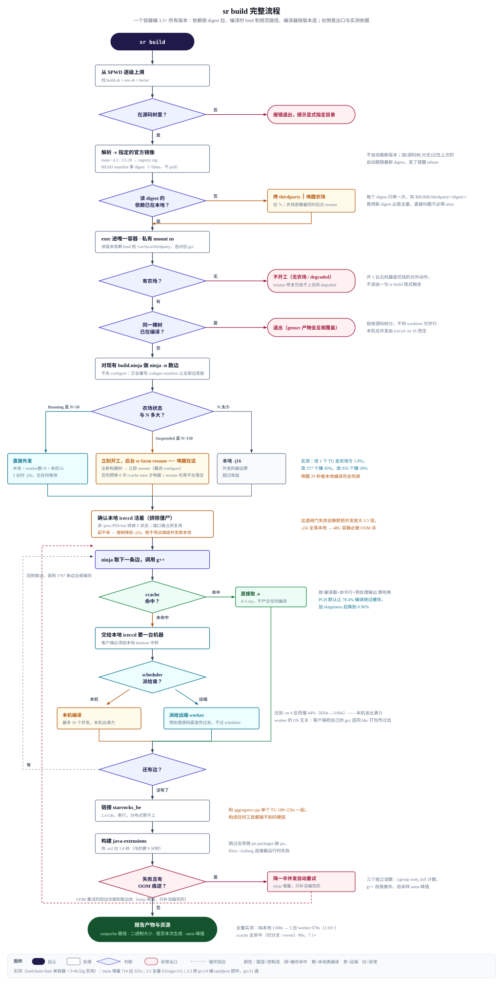

# srdev — StarRocks BE 编译加速工具链

在一台多人共享的开发机上，用**一个容器**编译 StarRocks 3.3 到 main 的所有版本：
ninja + 解开 PCH 锁的 ccache + 按需唤醒的 icecc 云端编译农场。所有默认值都来自实测，`sr-build --why` 能打印依据。

```
sr -v main build          # 编 main：首次拉该版本的官方依赖（~7s），之后记住
sr -v 3.5.20 build        # 同一个容器编 3.5，自动换 gcc11 + 对应 thirdparty，不重建容器
sr farm init              # 申请 5 台 8c32g 当 worker，编译够大时自动外发
sr history                # 每次编译的概况：耗时、边数、命中率、内存峰值
```

## 实测收益（main，16 核封顶开发机）

| 手段 | 场景 | 结果 |
|---|---|---|
| make → ninja | 全量 | 2768s → 1933s（1.43×），CPU 利用率 56% → 84% |
| ccache `sloppiness=pch_defines,time_macros` | 回退 / 切分支 | 1825s → 392s（4.66×）；默认配置下 78.4% 的编译因 PCH 绕过缓存 |
| icecc 农场 5×8c32g | 全量 | 1308s → 678s（1.93×）；只在重编规模够大时兑现 |
| 三者叠加，全命中 | 切分支再切回 | 99s（含链接与 java-extensions） |

## 组成

```
sr                      宿主机唯一入口：起容器、解析版本、拉依赖、转发到容器内
Dockerfile              单镜像：官方 toolchains 镜像 + gcc 11/12/13 + ninja/ccache/icecc + 每个 gcc 一份 icecc 工具链包
files/sr-build          容器内编译驱动：ninja/ccache/icecc 编排、异步唤醒农场、OOM 识别与重试、编译记录
files/sr-farm           农场生命周期：申请、下发 icecc、续约看门狗、闲置休眠、resume 校验/修复/降级
files/node-setup.sh     在 worker 节点上执行：清掉预装服务、装 icecc、写配置并回读校验
files/tspapi.py         云平台（TSP）的极简客户端，标准库实现；换平台只需重写这一个文件
files/cxxlaunch         CMAKE_CXX_COMPILER_LAUNCHER，绕过 ccache 做纯计时时用
files/ccache.conf       PCH sloppiness、75G 上限、zstd 1 级
files/oss-ccache-proxy.py  ccache 的 http 远端 → 阿里云 OSS 的签名代理（ccache 无 S3/OSS 后端）；conf 配桶名即启用
docs/sr_flowchart.svg   一次 sr build 的完整流程
```



## 快速开始

前提：docker；一个能匿名访问 v2 API 的内网 registry，里面镜像了 `starrocks/toolchains-ubuntu` 与各版本 `starrocks/dev-env-ubuntu`；
要用农场的话，宿主机上有云平台凭据 `~/.tsp/config.json`。

```bash
git clone <this repo> ~/srdev && cd ~/srdev
cp srdev.conf.example srdev.conf          # 填 registry、base 镜像、apt 源、公共依赖目录、节点账号
cp registries.conf.example registries.conf # 填版本号 -> dev-env 镜像的映射
ln -s ~/srdev/sr ~/bin/sr
cd /path/to/starrocks && sr build          # 默认 BE+FE（--be / --fe 单选）；首次会问你依赖版本，输 main 或 4.0 这样即可（或 -v 直接指定）；没镜像会先自动构建（~5 分钟）
sr farm init                               # 可选：建农场。没有农场时 sr build 会询问是否先本机编
sr build --ut                              # BE 单测只编不跑（默认 ASAN，同样走农场+ccache）；sr ut -- --test Foo 编完接着跑
```

`sr farm usage`（可 `--watch 5`）看农场资源：scheduler 的各 worker 槽位与负载、每台机器的 loadavg/内存/编译进程、本容器 CPU/内存。`sr help` 列出全部子命令；`sr build --help` / `sr build --why` 看编译选项与默认值依据。

## 版本是怎么处理的

版本差异只有两样，都用「指路」解决，容器永不因换版本而重建：

- **thirdparty**：`-v 4.1` 经 `registries.conf` 解析成官方 dev-env 镜像 tag，`HEAD /v2/.../manifests/<tag>` 拿到 content digest（~50ms，不 pull）。
  该 digest 首次出现时把镜像里的 `/var/local/thirdparty/installed` 拷到公共目录 `$SR_TPDIR/<digest>/installed/`（flock + 临时目录 + 原子 mv，多人同时拉不冲突），
  全机共享、按内容寻址、永不改写。编译时在私有 mount namespace 里把它 bind 到规范路径 `/var/local/thirdparty`
  ——CMakeCache 会把首次 configure 找到的绝对路径缓存起来，路径必须恒定；私有 ns 让不同版本能并发。
- **编译器**：拉依赖时记下该镜像的 gcc 大版本（`.gccmajor`），编译时用 `STARROCKS_GCC_HOME=/opt/gccNN` 指过去；icecc 工具链包也按 gcc 分别打好。
  gcc 是决定性变量：gcc14 编不过 3.3 的 rapidjson，gcc11 可以。

版本按「源码树 + 分支」记住（首次交互选择或 `-v` 指定），切分支要重新选/指定。之后**自动跟随**该版本 tag 的最新依赖镜像（加依赖不会破坏老代码）；digest 变了会提示——若编译报依赖相关错误，说明依赖升级而你的代码还没跟上，先 rebase。

## FE（maven）

`sr build --fe` 走 build.sh 的 maven 流程，农场与 ccache 不参与。实测（16 核）：冷编译 3m45s，其中 fe-core 的 checkstyle 105s（含测试共 5567 个文件；
它的缓存在 `target/checkstyle-cachefile` 里，不 `--clean` 时只要 0–1s）、javac 45s、测试编译 30s。无改动重跑也要 83s：thrift/proto 每次重新生成源码，
maven-compiler-plugin 3.1 据此判定「Changes detected」整模块重编 4670 文件。汇报里的「javac 重编 N 个模块」按各模块输出目录归属统计，`-T` 并行下也准。

## BE 单测

`sr build --ut` 驱动上游 `run-be-ut.sh`：它和 build.sh 一样认 `$CCACHE`、`CMAKE_BUILD_PREFIX`、`BUILD_TYPE`、`STARROCKS_GCC_HOME` 和 `-j`，
所以农场、ccache、按 digest 挂依赖整套机制原样适用；构建树是 `be/nj/ut_build_<类型>`，边数约为主程序的两倍（src+test 都编）。
类型默认跟上游一样是 ASAN（`--debug` / `--release` 可改），与 `sr build` 的 Release 树互不干扰，ccache 条目也互不覆盖。

上游脚本没有"只编不跑"的开关，`--dry-run` 正好是"全部编完、只打印要跑的测试"，就拿它当只编。`sr ut`（即 `sr build --ut --run`）
分两阶段：先按上面的方式编完，再调一次 `run-be-ut.sh` 跑测试。带 `--ut` 时 sr 不认识的参数会原样交给 `run-be-ut.sh`，
不用写 `--`：`sr ut --test CompactionUtilsTest`、`sr ut --gtest_filter 'A*:B*'`、`sr ut --module storage`。
第二阶段会再过一遍 maven/gensrc/cmake（约 1 分钟），ninja 应无事可做；跑测试期间不再打农场心跳，农场按空闲正常休眠。

两点上游行为要知道：`--clean` 除了删单测树还会删 `be/output/`（BE 主程序产物）；上游每次调用都无条件对 `test/starrocks_test` 做 objcopy
拆分调试符号，二进制没重新链接时再拆会把上一次完整的 `.debuginfo` 覆盖成空壳，所以 sr 把拆分收回来自己做，只拆本次重新链接出来的。
别绕过 sr 直接跑 `./run-be-ut.sh`：它会用另一套 launcher/构建目录重新 configure，等于从头本地全编一遍。

链接有单独的 ninja 并发池（`files/cmake-linkpool`，经上游 `CUSTOM_CMAKE` 钩子在 configure 时注入 `CMAKE_JOB_POOL_LINK`）。
上游没有任何 JOB_POOL，链接并发等于编译并发，而链接不经 icecc：ASAN 单测上百个 ld.lld 各 2~4G，实测 `-j80` 时 35 个同时跑撞上限被杀，
`-j8` 时 8 个也把 24G 容器顶在 memory.max 上反复回收、进度停在 thrift 检查之后不动。池大小按容器内存算（(内存-4G)/8G，钳 1~4），`SR_LINK_JOBS` 可改。

## 农场

- scheduler 跑在客户端容器里（实测 3.2MB / 0.5% CPU，纯中介，源码和产物 client↔worker 直连），申请到的机器全部当 worker。
- 端口与 netname 按 uid 推导，共享机上每个用户一套互不串台；容器 `--network host --init --privileged`，cgroup slice 限额。
- 续约是**死人开关**：看门狗每 15 分钟把到期时间重置为 3 小时后；容器一死，续约停止，农场自我了断。闲置 15 分钟休眠，`resume` 约 29 秒。
- 编译不等唤醒：按满并发直接开工，后台轮询累计 ccache miss，攒够 8 次才叫醒农场（全命中的编译不吵醒它）。
- `resume` 后实测 worker 连接数，不够就重新下发配置，仍不够标 `degraded`，`sr build` 拒绝开工而不是静默全落本地把容器 OOM 掉。
- 远端任何故障都是软降级（icecc 回退本地）；真正致命的是本机 iceccd 静默失效，因此 `sr-build` 开工前会读 `/proc/<pid>/stat` 排除僵尸。
- `sr farm usage` 里某台 worker `speed=0` 且从不接任务：icecc scheduler 有了其它主机的统计后不再尝试没统计的主机（env 缓存空的节点会一直饿着）。`sr farm rebalance` 重启 scheduler 让统计清零即可，实测修好过一台 5 天零任务的 worker。

## 多用户

每个用户一个容器 `<user>_farm`、一个 cgroup slice、一套端口；ccache 在各自 `~/ccache`（同一目录内 Debug/Release/ASAN 互不干扰）；
thirdparty 走公共目录全机共享；`~/farm/builds.tsv` 与 `~/farm/logs/` 记录每次编译。

## ccache 远端上 OSS

ccache 4.x 的远端只有 http / redis / file。`files/oss-ccache-proxy.py` 在容器里监听，把 ccache 的 GET/HEAD/PUT/DELETE 转成 OSS V1 签名请求，
凭据只从各人自己的 `~/.ossutilconfig` 读。`srdev.conf` 里配上桶名即启用，`sr build` 自动起代理、自动接上：

```
SR_CCACHE_REMOTE_BUCKET=<桶名>
SR_CCACHE_REMOTE_PREFIX=ccache/
```

两级读穿：本地命中不走网，本地 miss 才查远端并回填本地。缓存 key 与目录无关（以源码树根为 `CCACHE_BASEDIR`、`hash_dir=false`），
同一份代码放在谁的哪个目录都命中同一批对象。实测 main Debug 全量（5 worker 农场）：

| 场景 | 用时 | 命中 |
|---|---|---|
| 空本地 + 空远端（真编 + 上传 3.2 GB / 3244 对象） | 11m40s | 0 |
| **空本地 + 已填充远端**（新人 / 新机器首次编） | **1m51s** | 远端 97% |
| 本地全命中（对照） | 1m32s | 本地 99.9% |

远端命中比本地只慢约 20 秒。能跨机共享的前提是 PCH 走 `.sum` 哈希（见 `files/ccache-pch`），否则用了 PCH 的 TU 一个也命中不了。

## 换掉云平台

`files/tspapi.py` 是唯一和平台耦合的地方，`sr-farm` 只用它的 `create / cid / nodes / spec / row / op` 六个子命令（申请、查 id、查节点 IP、查规格、查到期时间、续约/启停/释放）。
按同样的输出格式重写即可接别的平台。

## 不要提交的东西

`srdev.conf`、`registries.conf`（已在 `.gitignore`）、`~/.tsp/`、`~/.ossutilconfig`、`~/farm/`（含 ssh 私钥与状态）。
