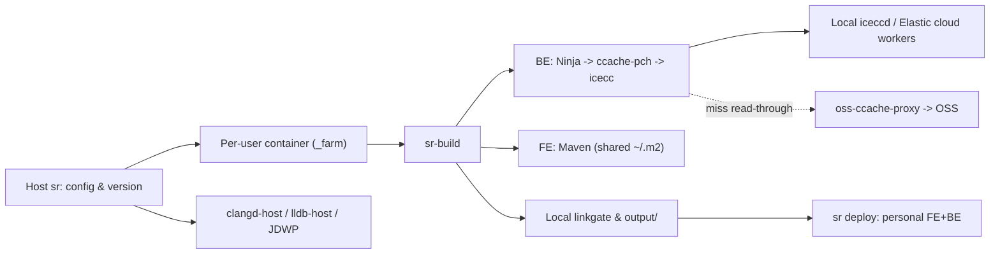

# srdev

**One persistent container. Every StarRocks version (`3.3` → `main`). From 46-minute full builds down to 99 seconds.**

`srdev` (`sr`) is a unified Linux development toolkit for StarRocks engineers working across multiple branches and worktrees on shared hosts. Instead of rebuilding or juggling multi-gigabyte `dev-env` containers per branch, you run **one persistent container** that pairs the right `thirdparty` snapshot and GCC toolchain on every command—combining **PCH-aware two-tier caching (`ccache` + OSS)**, an **on-demand elastic `icecc` compile farm**, **fast `.so` ASAN unit tests**, **per-user local FE/BE deployment**, and **zero-config containerized `clangd 20` / `LLDB 20` / Java JDWP debugging**.

---

## Measured Impact

Benchmarked on StarRocks `main` inside a 16-core / 64 GB capped container paired with an elastic `5 × 8c32g` `icecc` worker farm (run `sr build --why` to inspect the empirical basis behind every default):

| Workflow | Baseline | With `srdev` | Speedup / Gain |
|---|---|---|---|
| **Full BE build (cold → farm → warm)** | `2768s` (~46m, `make`) / `1308s` (local Ninja) | **`678s`** (5-worker farm) → **`99s`** (warm branch switch, incl. link & `java-extensions`) | **4.1×** cold / **28×** warm |
| **Branch switch / `--clean` rebuild (`WITH_PCH=ON`)** | `1825s` (78.4% of TUs bypass stock `ccache`; **0%** hit after `--clean`) | **`392s`** (`sloppiness`) → **`94s`** (`.gch.sum` deterministic PCH checksum, **99.9%** hit) | **19×** faster `--clean` rebuild |
| **First build on a brand-new machine / fresh clone** | `11m 40s` (empty local cache, full Debug compile) | **`1m 51s`** (97% remote hit from shared OSS cache; vs. `1m 32s` local SSD hit) | **6.3×** faster onboarding |
| **BE ASAN unit-test linking (56 targets)** | `408s` wall / **`38.0 GB`** anon RAM (static link; OOMs at high `-j`) | **`121s`** wall / **`7.6 GB`** anon RAM (`.so` dynamic UT + auto-injected PCH + `linkgate`) | **3.36×** faster, **5×** less RAM |
| **Multi-branch container footprint** | One ~14 GB `dev-env` container per branch | **1 persistent container** (~2.56 GB `toolchains` base) + ~7s digest-addressed `thirdparty` mount | **0** container rebuilds |
| **IDE C++ navigation on a fresh clone** | Full BE build required before `clangd` works | **`sr compdb` in ~14s** (isolated tree + Thrift/Proto codegen + per-branch host header jumps) | Ready in **14s** |

> *Timings above reflect measured baselines on the reference development host and are not cross-environment guarantees. Supported branches depend on the dependency images in your registry, bundled GCC versions, and upstream build scripts.*

---

## 60-Second Tour

```bash
sr -v main build            # Build main (BE+FE Release): pulls thirdparty in ~7s once, then remembers per worktree+branch
sr -v 3.5.20 build --be     # Build 3.5 in the SAME container: auto-switches to gcc11 + matching thirdparty
sr be-ut --module storage   # Build & run BE unit tests (ASAN + shared libs + PCH by default; --no-run to compile only)
sr fe-ut --test DemoTest    # Run FE unit tests in-container (JDK 21 + Maven + shared ~/.m2 + worktree lock)
sr farm init                # Provision elastic cloud workers; large builds burst remotely, warm builds let it sleep
sr compdb && sr ide         # Generate compile_commands.json in ~14s and wire containerized clangd 20 into VS Code
sr deploy                   # Deploy current output/ to your personal FE+BE cluster & configure LLDB + JDWP attach
sr history                  # Live progress & build history: duration, edges, cache hit rate, peak anon memory
```

- **AI Agent Skill**: [`skills/srdev/SKILL.md`](skills/srdev/SKILL.md) (drop-in skill for Codex / Claude / Cursor / Antigravity)
- **Contributor & Test Guide**: [`docs/development.md`](docs/development.md)

---

## Why `srdev` Exists

Building StarRocks C++/Java at scale on shared multi-developer Linux hosts hits five recurring bottlenecks—each solved directly in `srdev`:

1. **Multi-Version Isolation Without Container Sprawl**
   Official `dev-env` images bundle a specific GCC and `/var/local/thirdparty` per branch (`3.3` needs GCC 11 for `rapidjson`; `main` needs GCC 14). `sr` resolves tags via a ~50 ms HTTP `HEAD`, extracts `thirdparty` once into a host-shared content-addressed cache (`$SR_TPDIR/<sha256>/installed/`), and bind-mounts it inside a **per-command private mount namespace** onto `/var/local/thirdparty` while pointing `STARROCKS_GCC_HOME` to GCC `11 / 12 / 13 / 14`. Multiple worktrees across different versions compile concurrently in one container without `CMakeCache.txt` path drift.
2. **Deterministic Precompiled Header (PCH) & Shared OSS Caching**
   GCC `.gch` precompiled headers are non-reproducible byte-for-byte, and CMake passes `-include cmake_pch.hxx` while building the PCH itself—causing stock `ccache` to reject or miss every TU whenever a PCH is rebuilt. `files/ccache-pch` computes a deterministic `v5` SHA-256 over `-E -fdirectives-only` output with GCC-accurate `-ffile-prefix-map` normalization (`.gch.sum`) plus `CCACHE_BASEDIR` path relativization. Paired with `files/oss-ccache-proxy.py`, cache hits are shared across directories, worktrees, and teammates via Alibaba Cloud OSS.
3. **Wake-on-Miss Elastic `icecc` Build Farm**
   `icecc-scheduler` runs inside the developer's container (`3.2 MB` RAM, `0.5%` CPU), turning 100% of cloud VMs into compile workers. Sleeping farms never block build startup: `sr-build` starts immediately against local `iceccd` slots and only wakes the cloud farm in the background once cumulative `ccache` misses reach threshold (`8`), auto-suspending after 15 minutes of idle time and renewing leases via a dead-man's-switch watchdog.
4. **OOM-Proof Linking & Fast Dynamic BE Unit Tests**
   Upstream StarRocks sets no Ninja link job pool, so `-j80` distributed builds can spawn dozens of `3–15 GB` `ld.lld` processes on the local host at once. `srdev` injects both per-Ninja `CMAKE_JOB_POOL_LINK` and a container-wide `flock` semaphore (`files/linkgate`), and defaults `sr be-ut` to `.so` dynamic linking while re-attaching upstream's missing PCH via `CMAKE_PROJECT_INCLUDE` (`files/dynlib-compat.cmake`)—without touching a single line of StarRocks source.
5. **Container-Native IDE Navigation & Debugging**
   Host `clangd` and `lldb` cannot resolve `/opt/gcc-toolset-14` headers or container-mounted thirdparty `.so` libraries. `files/clangd-host` and `files/lldb-host` enter the container's private mount namespace transparently over stdio (LSP / DAP), while `sr compdb` uses an isolated tree with host-identical `$SR_TPDIR/<digest>` paths so VS Code **Go to Definition** opens the exact branch-matched thirdparty header.

---

## Architecture & Repository Layout



```text
sr                        Host entrypoint: container lifecycle, version resolution, thirdparty extraction, dispatch
Dockerfile                Single image: toolchains base (GCC 14) + GCC 11/12/13 + Ninja/ccache/icecc + LLVM 20
files/sr-build            In-container build driver: Ninja/ccache/icecc orchestration, async farm wake, OOM diagnostics
files/ccache-pch          Compiler launcher generating deterministic .gch.sum checksums for cross-machine PCH hits
files/ccache.conf         PCH sloppiness, external checksums, hash_dir=false, 75 GB cap, zstd level 1
files/oss-ccache-proxy.py Local HTTP -> Alibaba Cloud OSS V1 signing proxy with per-user Bearer auth
files/cmake-linkpool      CMake wrapper injecting Ninja link pools and container-wide linkgate without editing SR source
files/linkgate            Container-wide flock semaphore capping concurrent ld.lld memory pressure across worktrees
files/dynlib-compat.cmake CMake DEFER hook restoring PCH support for dynamic (.so) BE unit-test builds
files/sr-farm             Elastic farm manager: provisioning, icecc rollout, dead-man's-switch watchdog, auto-suspend, warmup
files/node-setup.sh       Worker bootstrap: stops preinstalled services/unattended-upgrades, installs & verifies iceccd
files/tspapi.py           Zero-dependency Python stdlib cloud adapter (swap cloud providers by replacing this one file)
files/sr-tp-prune.py      Safe host-wide thirdparty cache garbage collector with inode read/write locking
files/sr-deploy           Per-user single-node FE+BE deployer with UID port allocation, data retention & JDWP setup
files/sr-vscode.py        Comment-preserving JSONC merger for .vscode/settings.json and .vscode/launch.json
files/clangd-host         Host LSP wrapper running clangd 20 inside the container with branch-matched thirdparty mounts
files/lldb-host           Host DAP/CLI wrapper running lldb-dap-20 / lldb-20 in-container with isolated runtime libraries
```

---

## Quick Start

### Prerequisites
- **Host**: Linux `x86_64`, Bash, GNU coreutils (`readlink`, `stat`, `md5sum`), `flock`, Python 3, `curl`, `git`, and Docker access.
- **Registry**: An internal registry supporting anonymous HTTP v2 `tags/list` and `HEAD manifests` mirroring `starrocks/toolchains-ubuntu` and `starrocks/dev-env-ubuntu` tags.
- **Optional Cloud Features**: `~/.tsp/config.json` on the host for elastic `sr farm`, and `~/.ossutilconfig` (`ossutil`) for remote `ccache` / `sr pack --upload`.

### Installation & First Local Build

```bash
git clone https://github.com/Wenjun7J/sr-dev.git ~/srdev && cd ~/srdev
./install.sh                              # Verify host deps, install ~/bin/{sr,clangd,lldb,lldb-dap}, seed config templates
source ~/.config/srdev/env                # Load PATH in current shell (added automatically to shell profile)

# Edit srdev.conf and registries.conf with your registry host and base toolchains image
cd /path/to/starrocks
sr -v main build --be --dist off          # First non-interactive build requires -v; --dist off runs purely locally
sr build --all --dist off                 # Build BE+FE (Release by default), reusing remembered version for this worktree+branch
sr be-ut --dist off --no-run              # Build BE unit tests (ASAN + .so + PCH by default; omit --no-run to execute)
```

- **No cloud credentials needed to start**: `--dist off` uses Docker, extracted `thirdparty`, and local `ccache` without TSP or OSS configuration. When ready for distributed builds, configure worker settings and run `sr farm init` (which provisions cloud VMs), then omit `--dist off`.
- **Mount visibility**: StarRocks worktrees must reside under the container's mounted workspace (`$WORK`, defaulting to `$HOME`). `~/srdev` is the tooling checkout, not a StarRocks worktree.
- **Content-addressed tool image**: `sr` hashes `Dockerfile`, helper scripts, and build args (`files/sr-image-id.py`). If a running container has an older image ID, `sr up/build/deploy` stops safely and prompts you to run `sr image` and switch via `sr down && sr up` when active builds/services are idle—never silently killing a working container.

---

## How Multi-Version Isolation Works

Version differences across StarRocks releases come down to two things—both solved by indirection so the container never needs rebuilding:

- **`thirdparty` by SHA-256 Digest**: `-v 4.1` resolves through `registries.conf` to a `dev-env` tag and fetches its manifest digest via `HEAD /v2/.../manifests/<tag>` (~50 ms, no image pull). On first sight, `/var/local/thirdparty/installed` is extracted atomically (`flock` + temp dir + `mv`) to `$SR_TPDIR/<digest>/installed/`, shared read-only across all users on the host. Each build enters a private mount namespace (`unshare -m`) and bind-mounts that digest to `/var/local/thirdparty`, keeping `CMakeCache.txt` paths constant while allowing different branches to build side by side.
- **Paired GCC & `icecc` Toolchains**: Extraction records the image's major GCC version (`.gccmajor`). Builds set `STARROCKS_GCC_HOME` (`/opt/gcc11`, `/opt/gcc12`, `/opt/gcc13`, or `/opt/gcc-toolset-14`) and pair the matching prebuilt `/opt/icecc/<gcc>/*.tar.gz` archive so remote workers compile with the exact same compiler ABI.

Versions are remembered per **`(worktree, branch)`** and automatically track the latest digest of the chosen tag. When an upstream tag advances to a new digest, `sr` notifies you and forces a clean reconfigure on affected BE trees so stale objects never mix with updated headers/libraries.

### Pruning Old Dependency Caches

```bash
sr tp                      # List extracted thirdparty digests on the host
sr tp prune                # Preview reclaimable digests (dry-run by default; never invokes sudo)
sr tp prune --yes          # Delete unreferenced digests when builds/clangd/LLDB are idle (uses sudo as needed)
```

Only complete 64-hex digest directories from configured registries are considered. `sr tp prune` retains every tag's current registry digest plus all digests pinned by any user's `farm/versions` or active `.run` build records (including custom `BASE` paths registered via `.sr-tp-ref-*`), and holds an exclusive inode `flock` across scan and removal while builds and IDE wrappers hold shared read locks.

---

## Build, Unit Test & Concurrency Controls

### BE Unit Tests (`sr be-ut`)
`sr be-ut` drives upstream `run-be-ut.sh` in two phases: first compiling with `--dry-run` (using `ccache` + `icecc` + digest-mounted `thirdparty`), then running tests while letting the compile farm idle-suspend normally:

```bash
sr be-ut --test CompactionUtilsTest
sr be-ut --gtest_filter 'Tablet*:Rowset*'
sr be-ut --module storage --no-run        # Compile only
```

- **Dynamic `.so` + PCH by default**: Builds into `be/nj-dyn/ut_build_ASAN` (`3.36×` faster linking, `1/5` memory) and re-attaches PCH via `files/dynlib-compat.cmake`. Pass `--no-dynlib` for static linking (`be/nj/ut_build_ASAN`) or `--no-dynlib-pch` (`SR_DYNLIB_PCH=0`) to fall back to `-include vector`.
- **Idempotent debug-symbol splitting**: Upstream `run-be-ut.sh` unconditionally runs `objcopy` on `starrocks_test`, which can clobber `.debuginfo` when the binary was not relinked. `sr-build` disables upstream splitting and splits symbols on a temporary copy only when `.gnu_debuglink` is absent.
- **Upstream `--clean` note**: `run-be-ut.sh --clean` also removes `be/output/`.

### Two-Tier Linker Gate & Per-Invocation Overrides
Linker jobs run locally and can consume up to ~`14.7 GB` anon memory per ASAN target (`starrocks_dw_test`). `srdev` enforces both per-Ninja `CMAKE_JOB_POOL_LINK` and container-wide `files/linkgate`, defaulting to:

```text
min(floor(CPU_quota / 5), floor((Mem_GiB - 5) / SR_LINK_MEM_GB))   # clamped to 1..8, SR_LINK_MEM_GB=15
```

Concurrency knobs follow **`non-empty env var > srdev.conf > default`** without editing config files or restarting containers:

```bash
SR_LOCAL_JOBS=6 SR_LINK_JOBS=1 sr -v main be-ut --dist off
SR_FE_UT_JOBS=4 sr fe-ut --test com.starrocks.utframe.Demo
```

### FE Builds & Unit Tests (`sr build --fe` / `sr fe-ut`)
Pure FE workflows run Maven inside the container (JDK 21, Maven 3.8.7, shared `~/.m2`) under the worktree lock without touching BE `thirdparty`, `ccache`, or the `icecc` farm. `sr-build` summarizes per-module Reactor timings and exact `javac` recompiled module counts.

---

## Local Cluster Deployment & Packaging

### Per-User Single-Node Cluster (`sr deploy`)

```bash
sr deploy                  # Stop existing personal cluster, swap binaries from current output/, keep meta/storage
sr deploy --be-only        # Replace BE only; leave FE untouched
sr deploy --clean-data     # Wipe FE meta & BE storage before starting
sr deploy --status         # Show source commit, PIDs, ports, JDWP endpoint, and MySQL command
sr deploy --stop
```

- Each user gets an isolated deployment in `~/farm/deploy` (`/farm/deploy` in-container).
- New deployments pick a 10-port block starting at `24000 + (uid % 300) * 20` (`+0..3` FE, `+4..7` BE, `+8` FE JDWP, `+9` starlet), coordinated across users via an abstract Unix socket lock (`files/sr-deploy-lock.py`) and persisted once activated so existing metadata never breaks BE identity.
- Automatically registers BE into FE via `ALTER SYSTEM ADD BACKEND` and caps FE/BE JVM heaps at `2g` by default (`--fe-heap` / `--be-heap`).

### Release-Compatible Artifact Packaging (`sr pack`)

```bash
sr pack                    # Create ~/pkg/<tree>-<short-sha>[-dirty].tar.gz matching official daily-build layout
sr pack --name custom-pkg  # Override archive and top-level directory name
sr pack --upload           # Validate bucket/prefix/collisions up front, compress with pigz, and upload to OSS
```

---

## Containerized IDE & Debugging (`clangd 20`, `LLDB 20`, Java JDWP)

### Instant `clangd` Setup (`sr compdb` + `sr ide`)

```bash
cd /path/to/worktree
sr compdb                  # ~14s: cmake --configure-only + Thrift/Proto codegen in isolated be/nj-compdb/
sr ide                     # Install ~/bin/clangd wrapper and merge clangd.path into .vscode/settings.json
```

- **Why an isolated `be/nj-compdb/` tree?** Upstream `--configure-only` writes `WITH_PCH=OFF` into `CMakeCache.txt`; running it in your real build tree would invalidate every TU and cause 100% `ccache` misses on the next build.
- **Accurate multi-version header jumps**: While real builds bind-mount `thirdparty` to `/var/local/thirdparty`, `sr compdb` points `STARROCKS_THIRDPARTY` directly at `$SR_TPDIR/<digest>`—a path identical on both host and container—so VS Code **Go to Definition** opens the exact header version pinned by each worktree.
- Every BE / BE-UT build also updates a relative `compile_commands.json` symlink at the worktree root ("last built tree wins"; disable with `SR_CC_LINK=0`).

### One-Click FE (Java JDWP) & BE (`LLDB 20`) Debugging
`sr deploy` automatically merges attach configurations into `.vscode/launch.json` (preserving comments and custom entries):

- **FE Java Attach**: Enables `-agentlib:jdwp=...,server=y,suspend=n,address=127.0.0.1:<port>` on FE (never on BE's embedded JNI JVM) for VS Code's *Debugger for Java*.
- **BE `starrocks_be` & Dynamic Unit-Test Debugging**: Installs `~/bin/lldb-dap` and `~/bin/lldb` (`files/lldb-host`), which enter the container with matching `thirdparty` mounts and invoke LLVM 20's `lldb-dap-20` / `lldb-20` from [apt.llvm.org](https://apt.llvm.org/). For `.so` unit tests without `RPATH`, `files/lldb-dap-env` writes `LD_LIBRARY_PATH` into `<ut_tree>/.sr-lldb-env` via `target.env-vars` so the debuggee finds StarRocks `.so` libraries **without** polluting `lldb-dap` with StarRocks's bundled `libLLVM`, and sets `detect_leaks=0` because LSan is incompatible with `ptrace`.

---

## Elastic Compile Farm & Shared OSS Cache

### Farm Lifecycle (`sr farm`)

| Command | Purpose |
|---|---|
| `sr farm init` | Check port collisions, provision worker VMs, install `iceccd`, start watchdog, and warm workers |
| `sr farm status` / `usage [--watch 5]` | Inspect cloud state, lease expiry, scheduler slots, per-node load/RAM/`cc1plus`, and container cgroups |
| `sr farm resume` / `suspend` | Manually wake (~29s) or suspend worker VMs |
| `sr farm rebalance` | Restart `icecc-scheduler` and pre-warm workers so zero-score hosts receive jobs |
| `sr farm down` | Release cloud VMs (verified via 3-state `exists` check) and stop the watchdog |

- **UID-isolated ports**: Scheduler (`18700 + 2*(uid%250)` and `+1`), local `iceccd` (`19700 + uid%500`), and OSS proxy (`20700 + uid%500`) isolate users on shared hosts, with explicit `SPORT` / `DPORT` / `SR_CCACHE_PROXY_PORT` overrides if modulo collisions occur.
- **Starvation self-healing**: `icecc-scheduler` stops trying uncalibrated hosts (`speed=0`) once other workers have stats (e.g., after daemon restarts). Both `rebalance` and the periodic watchdog (`warm_if_starving`) send a synthetic compile job to any `speed=0` worker so all nodes stay active.

### Shared Remote `ccache` on OSS
Set `SR_CCACHE_REMOTE_BUCKET` in `srdev.conf` (using credentials in `~/.ossutilconfig`). `sr-build` launches `files/oss-ccache-proxy.py` on loopback, verifies PID-namespace ownership and config SHA-256 before sending the per-user Bearer token, and enables read-through/write-back caching across worktrees and users:

| Scenario (`main` Debug full build, 5-worker farm) | Wall Time | Cache Hit Rate |
|---|---|---|
| Empty local + empty remote (full compile + upload `3.2 GB` / `3244` objects) | `11m 40s` | `0%` |
| **Empty local + populated remote** (new developer / fresh machine) | **`1m 51s`** | **`97%` remote** |
| Warm local SSD cache (reference) | `1m 32s` | `99.9%` local |

### Swapping the Cloud Provider (`files/tspapi.py`)
`files/tspapi.py` is the **only** cloud-platform-specific file. Re-implement its 7 subcommands (`create`, `cid`, `nodes`, `spec`, `row`, `op`, `exists`) to target AWS EC2, Alibaba Cloud ECS, Kubernetes, or static SSH hosts.

> **Critical contract for `exists`**: `sr farm down` relies on a **3-state exit code**—`0` (exists), `1` (confirmed absent), `2` (query/auth/network failure, **including unknown subcommands**). Returning `1` on an unknown subcommand or transient error would trick `sr farm down` into deleting local state and stopping lease cleanup while cloud instances keep billing.

---

## Security & Git Hygiene

Never commit site configuration, credentials, runtime state, or customer/production identifiers:
- Ignored local files: `srdev.conf`, `registries.conf` (and backups), `~/.tsp/`, `~/.ossutilconfig`, `~/farm/` (SSH keys, tokens, logs, deployments).
- `srdev.conf` is sourced as shell code—edit only trusted local files and keep examples strictly anonymous.
