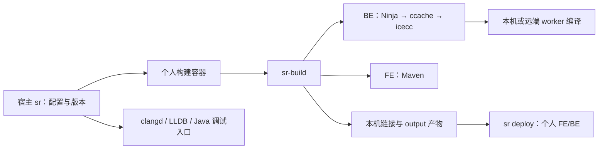

# srdev — StarRocks BE 编译加速工具链

在一台多人共享的 Linux 开发机上，用**一个容器**编译多个 StarRocks 版本：
ninja + ccache + 按需唤醒的 icecc 云端编译农场，并统一 FE/BE 单测、本地部署、clangd 和调试入口。
可用版本取决于 registry 中的依赖镜像、镜像内的编译器和目标分支脚本；历史使用范围包括 3.3 到 main。
`sr build --why` 能打印历史调优依据，本文的实测数字不代表新环境的耗时保证。

AI 使用入口：[通用 srdev skill](skills/srdev/SKILL.md)。维护仓库与运行测试见 [开发说明](docs/development.md)。

```
sr -v main build          # 编 main：首次拉该版本的官方依赖（~7s），之后记住
sr -v 3.5.20 build        # 同一个容器编 3.5，自动换 gcc11 + 对应 thirdparty，不重建容器
sr farm init              # 申请 5 台 8c32g 当 worker，编译够大时自动外发
sr history                # 每次编译的概况：耗时、边数、命中率、内存峰值
```

## 实测收益（main，16 核封顶开发机）

| 手段 | 场景 | 结果 |
|---|---|---|
| make → ninja | 全量 | 2768s → 1933s（1.43×），CPU 利用率 56% → 84% |
| ccache `sloppiness=pch_defines,time_macros` | 回退 / 切分支 | 1825s → 392s（4.66×）；默认配置下 78.4% 的编译因 PCH 绕过缓存 |
| icecc 农场 5×8c32g | 全量 | 1308s → 678s（1.93×）；只在重编规模够大时兑现 |
| 三者叠加，全命中 | 切分支再切回 | 99s（含链接与 java-extensions） |

## 组成

```
sr                      宿主机唯一入口：起容器、解析版本、拉依赖、转发到容器内
Dockerfile              单镜像：toolchains base（提供 gcc14）+ gcc 11/12/13 + ninja/ccache/icecc + LLVM 20
files/sr-build          容器内编译驱动：ninja/ccache/icecc 编排、异步唤醒农场、失败诊断、编译记录；不自动重试
files/sr-deploy         用当前源码树的 output/ 部署个人 FE/BE，保留数据、检查端口并启用调试
files/sr-vscode.py      合并工作区 JSONC，安装个人 clangd/LLDB 入口
files/sr-farm           农场生命周期：申请、下发 icecc、续约看门狗、闲置休眠、resume 校验/修复/降级
files/node-setup.sh     在 worker 节点上执行：清掉预装服务、装 icecc、写配置并回读校验
files/tspapi.py         云平台（TSP）的极简客户端，标准库实现；换平台只需重写这一个文件
files/cxxlaunch         CMAKE_CXX_COMPILER_LAUNCHER，绕过 ccache 做纯计时时用
files/ccache.conf       PCH sloppiness、75G 上限、zstd 1 级
files/oss-ccache-proxy.py  ccache 的 http 远端 → 阿里云 OSS 的签名代理（ccache 无 S3/OSS 后端）；conf 配桶名即启用
docs/sr_flowchart.svg   早期构建流程的历史图，部分策略已变更
```



[早期详细流程图](docs/sr_flowchart.svg) 仅作历史参考，其中的自动重试、固定并发和部分版本策略已不适用。

## 快速开始

前提：Linux、Bash、GNU coreutils、flock、Python 3、curl、git，以及当前用户可以访问的 Docker daemon；一个能匿名访问 v2 API 的内网 registry，里面镜像了 `starrocks/toolchains-ubuntu` 与各版本 `starrocks/dev-env-ubuntu`；
要用农场的话，宿主机上有云平台凭据 `~/.tsp/config.json`。

```bash
git clone <this repo> ~/srdev && cd ~/srdev
./install.sh                              # 检查依赖、创建个人入口、补齐配置模板和 PATH；保留已有配置
source ~/.config/srdev/env                 # 当前终端加载 PATH；新终端会自动加载
# 编辑 srdev.conf 和 registries.conf：填写 registry、base 镜像等站点信息
cd /path/to/starrocks
sr -v main build --be --dist off           # 首次先完成本机 BE 构建；版本按目标分支明确选择
sr build --all --dist off                  # 构建 BE+FE，默认 Release；复用该树该分支的版本选择
sr be-ut --dist off --no-run               # 编译 BE 单测，默认 ASAN + 动态链接 + PCH；去掉 --no-run 即编完接着跑
```

首次非交互执行必须显式指定 `-v`。`--dist off` 明确选择本地编译，不需要 TSP 或 OSS 凭据；
仍会使用 Docker、依赖镜像和本地 ccache。要使用农场，再配置节点参数和 TSP 凭据后执行 `sr farm init`，
随后构建可省略 `--dist off`。`farm init` 会申请云资源，不是首次上手的必选步骤。
源码树必须位于容器可见的挂载路径内（默认用户 HOME）；`~/srdev` 本身不是待编译的 StarRocks 源码树。

`sr farm usage`（可 `--watch 5`）看农场资源：scheduler 的各 worker 槽位与负载、每台机器的 loadavg/内存/编译进程、本容器 CPU/内存。`sr help` 列出全部子命令；`sr build --help` / `sr build --why` 看编译选项与默认值依据。

工具镜像按 Dockerfile、工具文件和构建参数生成内容标识，相同版本可以共享，不同版本使用不同标签。
`sr up/build/deploy` 会检查运行容器的工具版本；发现不一致时会停止本次操作并提示升级。先 `sr image` 构建对应镜像，待现有构建和服务空闲后再 `sr down && sr up` 切换；不会自动删除正在工作的容器。

### 同机多人部署

每个用户默认有自己的容器和部署目录；同一用户的所有 worktree 共用一套部署。部署目录锁会阻止并发的 deploy/stop 互相覆盖。
新部署的端口基址默认 `24000 + (uid % 300) * 20`，已有部署保留原端口。FE 使用基址 +0..3，BE 使用 +4..7，JDWP 使用 +8，starlet 使用 +9。
新部署会自动避让被占用的端口段，并保存选择结果；同机 sr 部署通过网络命名空间中的锁协调端口分配。另一条部署进行中时会提示稍后重试，编译不受此锁影响。
已有数据或已启动过的部署保持原端口，发生冲突时在停止旧服务前报错。也可在 `srdev.conf` 中显式配置 `SR_PORT_BASE`。启用 Arrow Flight 时也检查其配置端口。
FE/BE 启动、SQL 就绪或注册失败时 deploy 返回非零，并保留启动日志。

## 版本是怎么处理的

版本差异只有两样，都用「指路」解决，容器永不因换版本而重建：

- **thirdparty**：`-v 4.1` 经 `registries.conf` 解析成官方 dev-env 镜像 tag，`HEAD /v2/.../manifests/<tag>` 拿到 content digest（~50ms，不 pull）。
  该 digest 首次出现时把镜像里的 `/var/local/thirdparty/installed` 拷到公共目录 `$SR_TPDIR/<digest>/installed/`（flock + 临时目录 + 原子 mv，多人同时拉不冲突），
  全机共享、按内容寻址、永不改写。编译时在私有 mount namespace 里把它 bind 到规范路径 `/var/local/thirdparty`
  ——CMakeCache 会把首次 configure 找到的绝对路径缓存起来，路径必须恒定；私有 ns 让不同版本能并发。
- **编译器**：拉依赖时记下该镜像的 gcc 大版本（`.gccmajor`），编译时用 `STARROCKS_GCC_HOME=/opt/gccNN` 指过去；icecc 工具链包也按 gcc 分别打好。
  gcc 是决定性变量：gcc14 编不过 3.3 的 rapidjson，gcc11 可以。

版本按「源码树 + 分支」记住（首次交互选择或 `-v` 指定），切分支要重新选/指定。之后**自动跟随**该版本 tag 的最新依赖镜像，并非固定 digest。
digest 变化会提示，已有 BE 构建树必要时强制 clean，防止旧依赖的产物被误用。
若出现依赖错误，先核对源码提交与依赖镜像是否匹配，再决定是否更新代码；不要自动 rebase 用户的工作分支。

### 清理旧依赖缓存

```bash
sr tp                      # 已提取到宿主机的依赖目录
sr tp prune                # 默认只预览，也可显式加 --dry-run
sr tp prune --yes          # 实际清理；构建、clangd、LLDB 必须空闲
sr tp --help
```

仅完整的 64 位 digest 目录参与清理。命令查询本地缓存记录的来源 tag，保留这些 tag 当前指向的 digest，
以及各用户 `farm/versions` 和构建 `.run` 记录引用的 digest（兼容 12 位旧记录）。版本记录也供 IDE 使用，
所以记录中的旧 digest 不会仅因 tag 更新而被删除。未知来源、损坏或不完整目录及 `.tmp`/`.stale` 残留保留。
registry、Docker 清单或引用读取失败时中止。实际删除前重新扫描，整个扫描和删除过程持有依赖目录的排他锁。

构建、依赖提取、clangd 和 LLDB 共用该目录的读锁；清理不能取得排他锁时直接退出。
用户的自定义 `BASE/farm` 会登记到依赖目录下的 `.sr-tp-ref-*`，容器删除后仍能找到引用；
也扫描共享该缓存的现有容器 `/farm` 挂载和系统用户默认 `~/farm`。已删除旧版容器且使用过自定义 BASE 的用户，
首次清理前需用新版 `sr up` 登记其目录。无权读取其他用户的引用，或执行 `--yes` 时，通过 sudo 运行宿主维护程序，
不会启动编译容器。非交互环境要求已具备免密 sudo 权限。

首次使用实际清理前，所有共享该缓存的 srdev 安装及容器都要升级到支持依赖锁的版本，并重启旧的 IDE 会话。
命令会拒绝仍挂载该缓存、但没有锁协议标识的旧容器（包括已停止的）。按正常升级流程在空闲时切换，
不会自动重启服务。删除的缓存无法直接撤销，但对应镜像仍可访问时可重新提取。
本命令不删除 Docker 镜像、源码、构建产物或 OSS 数据；也不会自动清理。

## FE（maven）

`sr build --fe` 走 build.sh 的 maven 流程，农场与 ccache 不参与。实测（16 核）：冷编译 3m45s，其中 fe-core 的 checkstyle 105s（含测试共 5567 个文件；
它的缓存在 `target/checkstyle-cachefile` 里，不 `--clean` 时只要 0–1s）、javac 45s、测试编译 30s。无改动重跑也要 83s：thrift/proto 每次重新生成源码，
maven-compiler-plugin 3.1 据此判定「Changes detected」整模块重编 4670 文件。汇报里的「javac 重编 N 个模块」按各模块输出目录归属统计，`-T` 并行下也准。

## BE 单测

`sr build --be-ut` 驱动上游 `run-be-ut.sh`：它和 build.sh 一样认 `$CCACHE`、`CMAKE_BUILD_PREFIX`、`BUILD_TYPE`、`STARROCKS_GCC_HOME` 和 `-j`，
所以农场、ccache、按 digest 挂依赖整套机制原样适用；默认动态构建树是 `be/nj-dyn/ut_build_<类型>`，静态模式为 `be/nj/ut_build_<类型>`，边数约为主程序的两倍（src+test 都编）。
类型默认跟上游一样是 ASAN（`--debug` / `--release` 可改），与 `sr build` 的 Release 树互不干扰，ccache 条目也互不覆盖。

上游脚本没有"只编不跑"的开关，`--dry-run` 正好是"全部编完、只打印要跑的测试"，就拿它当只编。`sr be-ut`
分两阶段：先按上面的方式编完，再调一次 `run-be-ut.sh` 跑测试。带 `--be-ut` 时 sr 不认识的参数会原样交给 `run-be-ut.sh`，
不用写 `--`：`sr be-ut --test CompactionUtilsTest`、`sr be-ut --gtest_filter 'A*:B*'`、`sr be-ut --module storage`。
BE 单测默认编成 .so（链接快 3.36 倍、内存 1/5），并给各模块补挂上游 .so 分支漏掉的 PCH（本地编译快约 5%，分布式无收益）；
`--no-dynlib` 回静态链接，`--no-dynlib-pch`（或 `SR_DYNLIB_PCH=0`）退回只补 `-include vector`。两者都不改源码树。
（旧名 `ut` / `--ut` 已删除，会明确报未知参数。）
第二阶段会再过一遍 maven/gensrc/cmake（约 1 分钟），ninja 应无事可做；跑测试期间不再打农场心跳，农场按空闲正常休眠。

两点上游行为要知道：`--clean` 除了删单测树还会删 `be/output/`（BE 主程序产物）；上游每次调用都无条件对 `test/starrocks_test` 做 objcopy
拆分调试符号，二进制没重新链接时再拆会把上一次完整的 `.debuginfo` 覆盖成空壳，所以 sr 把拆分收回来自己做，只拆本次重新链接出来的。
别绕过 sr 直接跑 `./run-be-ut.sh`：它会用另一套 launcher/构建目录重新 configure，等于从头本地全编一遍。

链接有两道并发闸门，都由 `files/cmake-linkpool` 在 configure 时经上游 `CUSTOM_CMAKE` 钩子注入：ninja 的 `CMAKE_JOB_POOL_LINK` 管住单次构建，
`files/linkgate`（`CMAKE_CXX_LINKER_LAUNCHER`，flock 抢槽）管住整个容器。只有前者不够：容器里可以同时有几棵树在编，每棵都按整个容器的内存算槽数，加起来照样撞上限。
闸门是共享的、槽位不带内存权重。默认并发取 CPU 和内存估算的较小值：
`min(floor(CPU配额/5), floor((内存GiB-5)/SR_LINK_MEM_GB))`，最后限制在 1..8。
`SR_LINK_MEM_GB` 默认 15，来自历史最坏链接的采样；这是估值，不是内存安全上界。
预算连一条都放不下时仍会串行执行并告警，需要结合实际内存压力调整。
闸门只是内存保护，任何一步不顺（没有 flock、槽目录建不了、槽文件打不开）都直接放行并在 stderr 说明，不让它成为构建失败的新原因。
上游没有任何 JOB_POOL，链接并发等于编译并发，而链接不经 icecc：ASAN 单测上百个 ld.lld 各 2~4G，实测 `-j80` 时 35 个同时跑撞上限被杀，
`-j8` 时 8 个也把 24G 容器顶在 memory.max 上反复回收、进度停在 thrift 检查之后不动。`SR_LINK_JOBS` 可覆盖默认并发。

## FE 单测

`sr fe-ut` 驱动上游 `run-fe-ut.sh`，纯 maven，农场和 ccache 都不参与（所以头部也不再打 ccache 那几行，
也不会为它启动 OSS 代理）。仍然走容器，为的是同一套 JDK 21 / maven 3.8.7 / 共享 `~/.m2`，
以及和编译共用同一把源码树锁——同一棵树不会一边编一边跑测试。日志和 `sr history` 一并记，模式列写 `FEUT`。

```bash
sr fe-ut                                       # 全部
sr fe-ut --test com.starrocks.utframe.Demo     # 单个类
sr fe-ut --filter com.starrocks.X#Test0        # 跳过某些
sr fe-ut --dry-run                             # 只准备环境不跑
```

并发由 `SR_FE_UT_JOBS` 控制，未配置时跟随 `SR_LOCAL_JOBS`，后者默认取容器 CPU 配额。
它控制 Maven reactor 的 `-T`，实际测试 JVM 数还受 surefire fork 配置影响，内存紧张时单独调低。
用户级 `-j` 已移除，BE 和 FE 均应通过配置调整。

## lldb 调试（VSCode / 命令行，都在容器里）

进程只能在编译容器里跑（链的是容器里的 gcc-toolset-14 运行库和按 digest 挂进去的 thirdparty），所以 lldb 也必须进容器：
`files/lldb-host` 与 clangd-host 同一套路，从 cwd 上溯找源码树、挂好同一份 thirdparty，再起 `lldb-dap-20`（VSCode）或 `lldb-20`（命令行）。
镜像通过 [LLVM 官方软件源](https://apt.llvm.org/) 安装 LLDB 20；`sr image` 固化版本，宿主入口仍为 `~/bin/lldb-dap` / `~/bin/lldb`。
它绝不往 stdout 写东西——那条管道就是 DAP 协议。

```bash
ln -sf ~/srdev/files/lldb-host ~/bin/lldb-dap   # VSCode 的 lldb-dap 扩展（llvm-vs-code-extensions.lldb-dap）用这个
ln -sf ~/srdev/files/lldb-host ~/bin/lldb       # 命令行：cd 源码树; ~/bin/lldb -- be/nj-dyn/ut_build_ASAN/test/exec/xxx_test --gtest_filter=...
```

`sr deploy` 部署后自动创建或补齐当前源码树的 `.vscode/launch.json`。
部署 BE 时建立宿主用户的 `~/bin/lldb-dap` 软链接和 LLDB 附加配置；部署 FE 时启用 JDWP 并生成 Java 附加配置。
`--be-only` / `--fe-only` 只处理对应组件；被跳过的组件保持原状态。部署命令不提供 `--debug` / `--release` 开关，也不改变 `sr build` 的编译类型。
VS Code Remote SSH 中安装 `llvm-vs-code-extensions.lldb-dap` 扩展，打开该 worktree，选择「附加到 sr deploy 起的 starrocks_be（lldb）」即可。
配置使用 `"debugAdapterExecutable": "${env:HOME}/bin/lldb-dap"`，由 VS Code 按远端用户展开，其他用户无需替换绝对路径；不需要额外写 `settings.json`。
源码映射使用 `${workspaceFolder}`，目标路径跟随 `SR_DEPLOY_DIR`（默认 `/farm/deploy`）。宿主机需要 Python 3，生成器只使用标准库。
已有 JSONC 注释和其他配置保留；同名 BE 配置仅更新适配器和部署产物路径，同名 FE 配置仅更新连接地址和端口，其他自定义字段保留。重复部署不会重复添加。
`--no-start` 也会生成配置；`--status`、`--stop`、帮助和失败的部署不生成。没有对应产物而被跳过的组件不生成。
已有文件解析失败或 `~/bin/lldb-dap` 被其他程序占用时会提示，不覆盖原文件。

### FE Java 调试

FE JVM 使用 `-agentlib:jdwp=transport=dt_socket,server=y,suspend=n,address=127.0.0.1:<端口>`。
端口默认部署端口基址 +8，可在 srdev.conf 中设 `SR_FE_DEBUG_PORT`；生成的 launch.json 读取实际部署端口。
启动前检查端口占用，发生冲突时在停止现有 FE 之前报错。容器使用 host 网络，VS Code Remote SSH 直接连接开发机的回环地址。
远端安装 `vscjava.vscode-java-debug`（及其 Java 语言支持依赖）并导入当前工作区的 FE Maven 项目，然后选择「附加到 sr deploy 起的 FE（Java）」。

工具按同机开发者互相信任来设计，允许其他本机用户连接容器中的服务和调试端口。各用户有自己的容器、部署目录和端口；部署锁与端口避让负责避免相互干扰。FE 调试仍监听 `127.0.0.1`，VS Code Remote SSH 可直接连接，同机其他用户也可连接；sr 不按 UID 限制访问，不管理宿主机防火墙，也无需配置访问模式。
默认 `projectName` 为 `fe-core`；已有配置中自行设置的项目名保留。

`suspend=n` 保证启动时不等待调试器，但启用调试 agent 仍可能影响运行性能，断点和单步会改变线程执行；本工具没有对 FE 的性能影响给出百分比保证。
部署脚本会同时处理旧分支的 `JAVA_OPTS_FOR_JDK_*`，替换旧 JDWP 参数，避免重复加载 agent；BE 的 JVM 参数不加 JDWP。

### BE LLDB 调试

- **附加到 `sr deploy` 起的 BE**：`"request": "attach", "program": "/farm/deploy/be/lib/starrocks_be", "waitFor": false`——按进程名附加
  （容器里只有一个 starrocks_be 时才唯一；也可用数字 `pid` 精确指定进程）。附加期间 BE 暂停，
  FE 心跳会超时，别挂太久。调试符号在旁边的 `starrocks_be.debuginfo`（`.gnu_debuglink`），lldb 自动找到。
- **BE 单测**（.so 树的二进制没有 RPATH）：适配器进程里给 `debugAdapterEnv.SR_UT_TREE` 指定构建树，`lldb-dap-env` 会把
  run-be-ut.sh 同款的 LD_LIBRARY_PATH 写成 `<构建树>/.sr-lldb-env`，launch 配置用 `initCommands: ["command source <构建树>/.sr-lldb-env"]`
  只交给被调试进程。**调试器自己不能沾这份路径**：此前 LLDB 18 曾误载 SR 自带的同名 libLLVM，
  报 `undefined symbol: LLVMInitializeAArch64TargetInfo`，因此升级后仍保留运行库隔离。ASAN 二进制加 `"disableASLR": false`。
  调试入口默认加 `ASAN_OPTIONS=...:detect_leaks=0`，因为 LSan 不支持 ptrace，测试通过后仍会报 fatal error；
  普通 `sr be-ut` 的泄漏检查不受影响。若自行设置 `ASAN_OPTIONS`，也需带上 `detect_leaks=0`。
  LLDB 20 已用动态链接的 `types_test` 验证源码断点、单步、局部变量、`p t` 和正常退出；DAP 附加到临时进程也通过。

## clangd

每次 BE 或单测构建完，`sr` 会在源码树根建一个指向本次构建树的 `compile_commands.json` 软链接：

```
compile_commands.json -> be/nj/build_Release/compile_commands.json
```

这样 clangd 永远在项目根找到它，不必因为切构建类型去改配置。语义是"最后编的那棵树赢"，
所以 `sr build --be-ut` 之后它指向 `ut_build_ASAN`，编辑测试代码时补全和跳转也是对的。
目标写成相对路径，源码树整个搬走仍然有效。这个文件名上游 `.gitignore` 里已经有了，不污染 `git status`。

根目录若已存在一个**真实文件**（不是软链接），`sr` 不会动它，只提示一句。要彻底关掉：`srdev.conf` 里设 `SR_CC_LINK=0`。

不想为了 clangd 编一整轮的话，用 `sr compdb`：

```bash
sr compdb            # 只生成 compile_commands.json，实测 14 秒（新克隆、从没编译过的树也是这个数）
sr compdb --asan     # 要 ASAN 的编译参数
```

它走 `build.sh --configure-only`，只做 cmake configure，再跑一遍 thrift/proto 代码生成
（否则 `gen_cpp/*.h` 不存在，clangd 会满屏报找不到头文件），然后把根目录软链接指过去。

**用的是独立构建树 `be/nj-compdb/`（约 32M），不碰真实产物。** 这一点不能省：`--configure-only` 会强制
`WITH_PCH=OFF` 并写进 CMakeCache，在真实构建树里跑一次，下次编译所有 TU 的命令行都变了，
等于全量重编加 ccache 全 miss。顺带一个好处是生成的数据库里没有 PCH 相关标志，clangd 更干净。

只覆盖 BE 主程序的源码（`MAKE_TEST=OFF`）。要让 clangd 认识 `be/test/` 下的测试代码，
跑一次 `sr build --be-ut`，它的 `compile_commands.json` 包含测试文件。

### clangd 必须跑在容器里

`compile_commands.json` 里的编译器是 `/opt/gcc-toolset-14/bin/g++`，头文件路径里有 `/var/local/thirdparty/installed/...`。
宿主机上前者根本不存在，`--query-driver` 问不出系统头路径，clangd 只能退回用发行版自带的 clang 头文件。
更隐蔽的是**容器默认命名空间里 `/var/local/thirdparty/installed` 也是空的**——真正的依赖是每次编译时按 digest
bind 进去的。所以 clangd 必须和编译用同一套挂载。

`files/clangd-host` 就是干这个的：从当前目录上溯找到源码树，读出这棵树钉住的依赖 digest，
然后 `docker exec -i` 进容器、在私有挂载命名空间里把依赖挂好再起 clangd。它绝不往 stdout 写任何东西，
因为那条管道就是 LSP 协议本身。

```bash
cd /path/to/worktree
sr ide  # 自动安装 ~/bin/clangd，并向本 worktree 的 .vscode/settings.json 补齐当前用户的路径
```

`sr deploy` 也会完成这一步。已有自定义 clangd.path 和其他设置会保留；配置采用 JSONC 合并，注释也会保留。远端需要安装 `llvm-vs-code-extensions.vscode-clangd` 扩展。
容器中的 clangd 使用 20.1.x，避免 clangd 18 在某些 C++ 泛型 lambda 上的崩溃。VS Code 因连续崩溃停止自动重启后，执行命令 `clangd: Restart language server`。

VSCode 侧：

```jsonc
// clangd.path 由 sr ide 自动生成当前用户的绝对路径
"clangd.arguments": [
  "--compile-commands-dir=${workspaceRoot}",
  "--query-driver=/opt/gcc*/bin/*",   // 一个 glob 覆盖镜像里全部四个 gcc（11/12/13/14）
  "--background-index", "--clang-tidy", "--header-insertion=never",
  "--all-scopes-completion", "--completion-style=detailed",
  "--j=8"                             // 容器是 16 核，开 32 个索引线程只会互相挤
]
```

### 多版本并行开发

每棵源码树各自钉一个依赖 digest，`clangd-host` 从当前目录上溯找到树、读出它的 digest，所以**每个 VSCode 窗口拿到的是各自那套依赖**。
示例（digest 为占位值）：`starrocks@branch-3.5.20` 解析到 `aaaaaaaa`（gcc11），`sample-worktree` 解析到 `bbbbbbbb`（gcc14），互不串。

跳转到第三方头文件要额外一层保证。clangd 把跳转解析成 `compile_commands.json` 里那个绝对路径，而 **VSCode 是在宿主机上打开它的**。
真实编译用的是 bind 到固定路径 `/var/local/thirdparty`——宿主机上那个位置只有一份共用的旧拷贝，两棵树会跳到同一份，
而且和各自钉住的依赖对不上（实测 gcc14 那份多出一整棵 `benchgen/` 头文件树，宿主机那份没有）。

所以 `sr compdb` 不做 bind，直接把 `STARROCKS_THIRDPARTY` 指向依赖在**宿主机上的真实路径** `$SR_TPDIR/<digest>`，
容器也按同名路径多挂一份，于是那条路径在容器内外指的是同一个东西，跳转落到各自版本的头文件上。
真实编译仍走 bind，因为 CMakeCache 会把首次 configure 的绝对路径缓存死，那条路径必须恒定、不能跟着 digest 变。

这意味着：**给 clangd 用的数据库要用 `sr compdb` 生成**（14 秒）。跑过 `sr build --be` 之后根目录软链接会指向真实构建树，
那份数据库里的第三方路径只在容器内成立；想恢复精确跳转，再跑一次 `sr compdb` 即可。

实测对比同一个文件：宿主机那份 clangd 的 stderr 里是
`driver execution failed - '/opt/gcc-toolset-14/bin/g++' doesn't exist`，并且会报一条
"protoc 版本比生成代码新"的假警告（它读到的是宿主机上一份过期的 thirdparty）；走容器之后这条假警告消失。

## 打包产物

`sr pack` 把当前源码树的 `output/` 打成与官方日构建同构的 tar.gz：包名与包内顶层目录同名，都是 `<树名>-<短sha>[-dirty]`，
里面就是 `be/`、`fe/`（构建时带上的话还有 `apache_hdfs_broker/`）和 `LICENSE.txt`/`NOTICE.txt`，不额外塞任何东西。
树里有未提交改动时包名会带 `-dirty`——官方包都来自干净的 CI 构建，拿一个带未提交改动的包去部署而不自知很难查。

```bash
sr pack                      # 只打包，落在 ~/pkg（或 SR_PKG_DIR）
sr pack --upload             # 打完传到 srdev.conf 里配的 SR_PKG_BUCKET/SR_PKG_PREFIX
sr pack --name my-build-1    # 自定义包名（同时决定包内顶层目录名）
```

上传必须显式加 `--upload`：往共享桶里推 4G+ 的对象是对外动作。桶名与前缀是站点信息，只从不入库的 `srdev.conf` 读
（`SR_PKG_BUCKET` + `SR_PKG_PREFIX`，前缀要以 `/` 结尾），目标就是 `oss://<桶>/<前缀><包名>.tar.gz`；凭据同样只用各人自己的
`~/.ossutilconfig`。没配桶、前缀格式不对、远端已有同名对象（需 `--force`）这几项都在压缩**之前**查完——压四分钟再报错没意义。
压缩走 `pigz`（默认 16 线程、级别 6），6G 产物压出来约 4.4G。

## 农场

- scheduler 跑在客户端容器里（实测 3.2MB / 0.5% CPU，纯中介，源码和产物 client↔worker 直连），申请到的机器全部当 worker。
- 端口与 netname 按 uid 推导，共享机上每个用户一套互不串台；容器 `--network host --init --privileged`，cgroup slice 限额。
  取模不是绝对隔离：`SPORT=18700+2*(uid%250)`、`DPORT=19700+uid%500`、代理 `20700+uid%500`，uid 相差 250/500 的两个人会撞。
  `sr farm init` 会在申请机器之前检出撞车并要求在 `srdev.conf` 里显式设 `SPORT`/`DPORT`/`SR_CCACHE_PROXY_PORT` 错开。
- 续约是**死人开关**：看门狗每 15 分钟把到期时间重置为 3 小时后；容器一死，续约停止，农场自我了断。闲置 15 分钟休眠，`resume` 约 29 秒。
- 编译不等唤醒：按满并发直接开工，后台轮询累计 ccache miss，攒够 8 次才叫醒农场（全命中的编译不吵醒它）。
- `resume` 后实测 worker 连接数，不够就重新下发配置，仍不够标 `degraded`，`sr build` 拒绝开工而不是静默全落本地把容器 OOM 掉。
- 远端任何故障都是软降级（icecc 回退本地）；真正致命的是本机 iceccd 静默失效，因此 `sr-build` 开工前会读 `/proc/<pid>/stat` 排除僵尸。
- `sr farm usage` 里某台 worker `speed=0` 且从不接任务：icecc scheduler 有了其它主机的统计后不再尝试没统计的主机（env 缓存空的节点会一直饿着）。`sr farm rebalance` 重启 scheduler 让统计清零即可，实测修好过一台 5 天零任务的 worker。

## 多用户

每个用户一个容器 `<user>_farm`、一个 cgroup slice、一套端口；ccache 在各自 `~/ccache`（同一目录内 Debug/Release/ASAN 互不干扰）；
thirdparty 走公共目录全机共享；`~/farm/builds.tsv` 与 `~/farm/logs/` 记录每次编译。

## ccache 远端上 OSS

ccache 4.x 的远端只有 http / redis / file。`files/oss-ccache-proxy.py` 在容器里监听，把 ccache 的 GET/HEAD/PUT/DELETE 转成 OSS V1 签名请求，
凭据只从各人自己的 `~/.ossutilconfig` 读。`srdev.conf` 里配上桶名即启用，`sr build` 自动起代理、自动接上：

```
SR_CCACHE_REMOTE_BUCKET=<桶名>
SR_CCACHE_REMOTE_PREFIX=ccache/
```

两级读穿：本地命中不走网，本地 miss 才查远端并回填本地。缓存 key 与目录无关（以源码树根为 `CCACHE_BASEDIR`、`hash_dir=false`），
同一份代码放在谁的哪个目录都命中同一批对象。实测 main Debug 全量（5 worker 农场）：

| 场景 | 用时 | 命中 |
|---|---|---|
| 空本地 + 空远端（真编 + 上传 3.2 GB / 3244 对象） | 11m40s | 0 |
| **空本地 + 已填充远端**（新人 / 新机器首次编） | **1m51s** | 远端 97% |
| 本地全命中（对照） | 1m32s | 本地 99.9% |

远端命中比本地只慢约 20 秒。能跨机共享的前提是 PCH 走 `.sum` 哈希（见 `files/ccache-pch`），否则用了 PCH 的 TU 一个也命中不了。

## 换掉云平台

`files/tspapi.py` 是唯一和平台耦合的地方。`sr-farm` 用它的 **七个**子命令：`create / cid / nodes / spec / row / op / exists`
（申请、查 id、查节点 IP、查规格、查到期时间、续约启停释放、判存在）。按同样的输出格式重写即可接别的平台。

`exists` 最容易被漏掉，而漏掉的后果是真金白银：`sr farm down` 先用它判断集群还在不在，**退出码有三态**——
`0`=存在（同时把状态打到 stdout）、`1`=确认不存在、`2`=查询失败。只实现前六个的话，新客户端遇到 `exists` 会按
"未知命令"返回 1，`down` 就把它当成"平台上已经没有了"，直接删本地记录、停看门狗，**根本不发释放请求**，
而用户看到的是"已释放"——集群还在平台上继续计费。所以：未知命令必须返回 2（查询失败），不能返回 1。

## 不要提交的东西

`srdev.conf`、`registries.conf` 及其备份、`~/.tsp/`、`~/.ossutilconfig`、`~/farm/`（含 ssh 私钥与状态）。
站点配置以 Shell 代码加载；只编辑可信配置，不要把实际值复制到示例、日志报告或 skill 中。
源码、分支名、提交信息及共享产物中不得包含客户信息；示例统一使用匿名数据。
